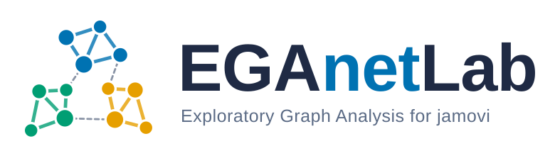
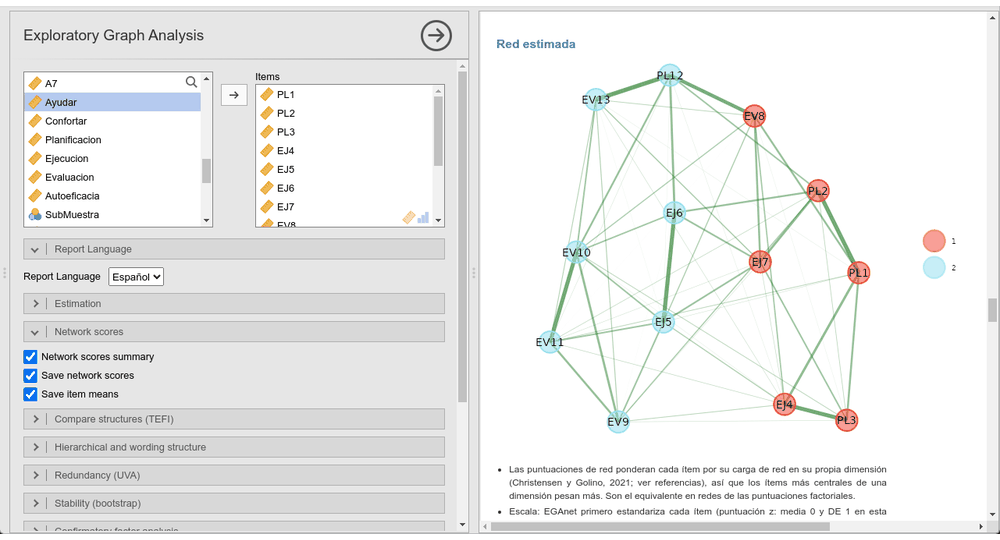
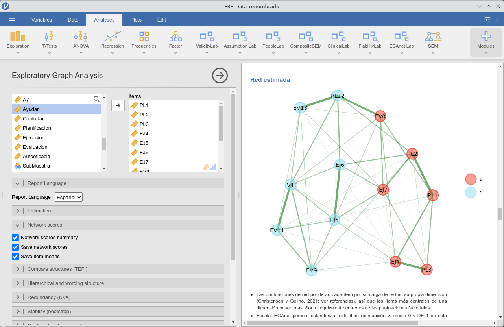
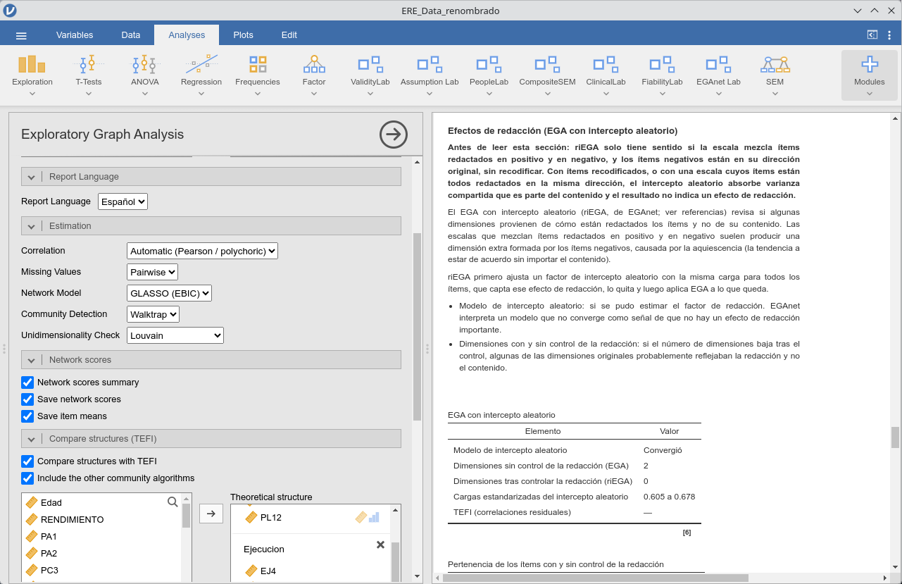
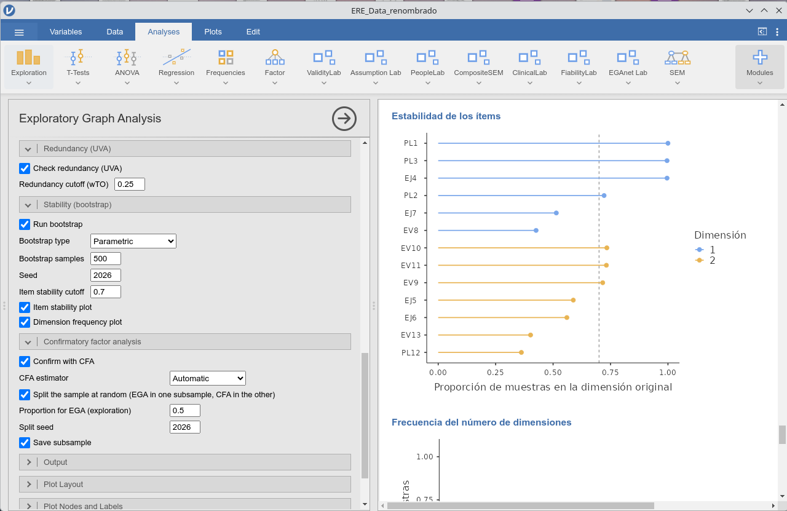
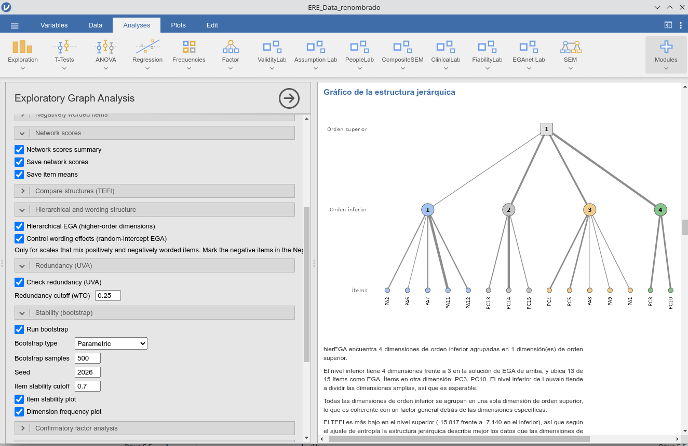
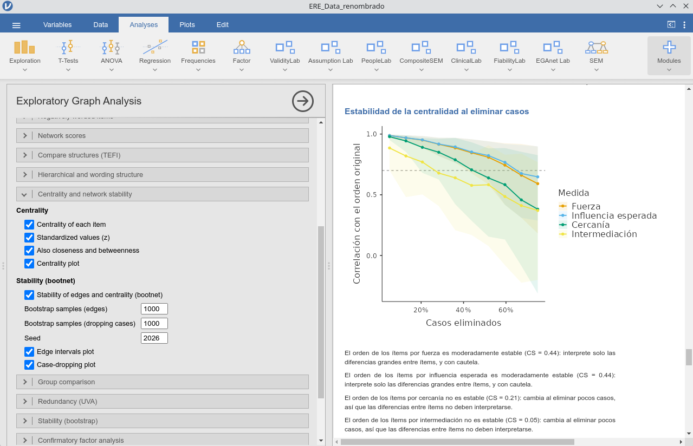
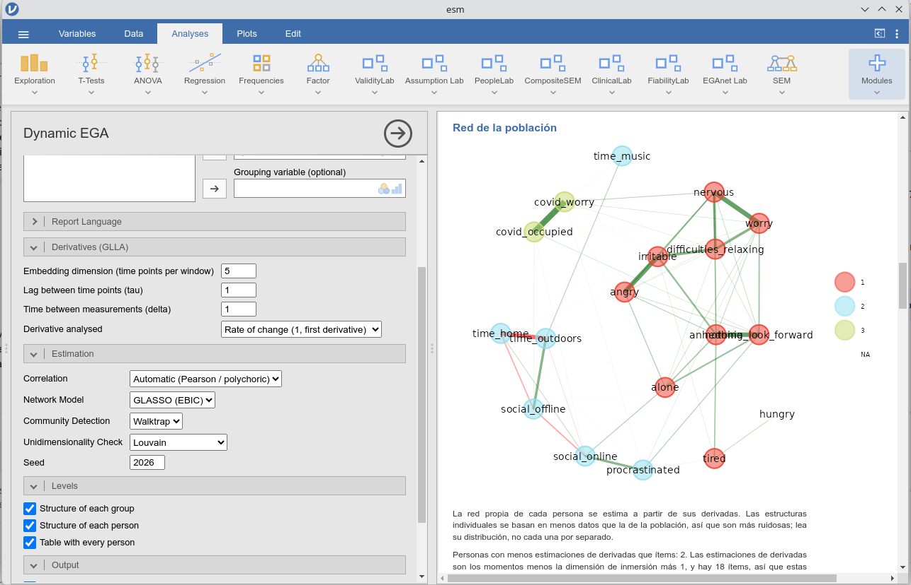

<p align="center">
  <picture>
    <source media="(prefers-color-scheme: dark)" srcset="docs/logo/eganetlab-logo-dark.svg">
    
  </picture>
</p>

<p align="center">
  <a href="LICENSE"></a>
  <a href="https://github.com/ArchieJamDev/EGAnetLab/releases"></a>
  <a href="https://github.com/ArchieJamDev/EGAnetLab/actions/workflows/jamovi-check.yml"></a>
  
  <a href="https://doi.org/10.5281/zenodo.23886111"></a>
  
</p>

> **A jamovi module for Exploratory Graph Analysis: how many dimensions your
> items measure, which items belong together, and how much you can trust
> that answer.**

EGAnetLab brings the network psychometrics of the
[EGAnet](https://r-ega.net) R package to [jamovi](https://www.jamovi.org/),
without writing a line of R. Like its sibling module
[AssumptionsLab](https://github.com/ArchieJamDev/AssumptionsLab), it does not
stop at the numbers: every option in the menu explains what it does and when
to choose it, and every result comes with a plain-language interpretation,
the evidence behind it and the next step to take.

---

## Contents

- [Why EGAnetLab?](#why-eganetlab)
- [Screenshots](#screenshots)
- [Analyses](#analyses)
- [Supported Data](#supported-data)
- [Network Graphics](#network-graphics)
- [Methodological Philosophy](#methodological-philosophy)
- [Installation](#installation)
- [Example Datasets](#example-datasets)
- [Testing](#testing)
- [For Developers](#for-developers)
- [Roadmap](#roadmap)
- [Contributing](#contributing)
- [Citation](#citation)
- [License & Author](#license--author)
- [Resumen en español](#resumen-en-español)

---

## Why EGAnetLab?

Deciding how many dimensions a scale has is one of the most consequential
choices in measurement, and one of the most error-prone. Eigenvalue rules
over-extract, parallel analysis wobbles with ordinal data, and an EFA solution
says nothing about how stable it would be in a new sample.

**Exploratory Graph Analysis** (Golino & Epskamp, 2017) estimates the items'
network of partial correlations and finds its communities: each community is a
dimension. Simulation studies show it is as accurate as or more accurate than
traditional methods, and EGAnet adds the tools that turn one estimate into a
full argument: bootstrap stability, redundancy checks, information-theoretic
fit, hierarchical and longitudinal structure, and invariance across groups.

EGAnetLab puts that whole toolkit in jamovi's point-and-click interface:

- **A menu of decisions, not a wall of defaults.** Correlation type, network
  model, community algorithm and every other choice is an explicit option,
  each with an explanatory paragraph.
- **Guidance with every table.** A short guide before each result and an
  interpretation after it, in English or Spanish.
- **Publication-ready network plots.** Communities in colorblind-safe
  palettes, with layout, nodes, edges and labels under your control.
- **Validated against EGAnet.** The module's results are checked against
  direct EGAnet calls (see [`validation/`](validation/)).

---

## Screenshots

<p align="center">
  
</p>

<table width="100%">
  <tr>
    <td align="center" width="50%">
      
      <p><em>Item network coloured by dimension, with the EGAnet Lab menu in jamovi</em></p>
    </td>
    <td align="center" width="50%">
      
      <p><em>Wording effects with random-intercept EGA (riEGA)</em></p>
    </td>
  </tr>
  <tr>
    <td align="center" width="50%">
      
      <p><em>Bootstrap stability of each item</em></p>
    </td>
    <td align="center" width="50%">
      
      <p><em>Hierarchical structure (hierEGA)</em></p>
    </td>
  </tr>
  <tr>
    <td align="center" width="50%">
      
      <p><em>Centrality and its stability (bootnet)</em></p>
    </td>
    <td align="center" width="50%">
      
      <p><em>Dynamic EGA for intensive longitudinal data</em></p>
    </td>
  </tr>
</table>

---

## Analyses

EGAnetLab is organised as a menu of decisions. Each analysis is one entry in
the **EGAnet Lab** menu, and each option inside it carries its own
explanation.

### 1. Dimensional estimation (EGA core)

| Analysis | Question it answers | Status |
|---|---|---|
| **EGA** | How many dimensions are there, and which items belong to each? | ✅ 0.1.0 |
| **Bootstrap EGA** (`bootEGA`) | Would the same dimensions appear in hundreds of resamples, or are they sample noise? | ✅ 0.1.0 (in EGA, Stability section) |
| **Hierarchical EGA** (`hierEGA`) | Do the specific dimensions sit under one or more higher-order factors? | ✅ 0.1.0 (in EGA, Hierarchical and wording section) |
| **Random-intercept EGA** (`riEGA`) | Are positively and negatively worded items splitting into method dimensions? | ✅ 0.1.0 (in EGA, Hierarchical and wording section) |
| **Dynamic EGA** (`dynEGA`) | How does the structure unfold over time, per person, per group or for the population? | ✅ 0.1.0 (own analysis: EGAnet Lab › Dynamic EGA) |

### 2. Diagnosis and psychometric quality

| Analysis | Question it answers | Status |
|---|---|---|
| **Network loadings** (`net.loads`) | How strongly does each item load on its dimension, and on the others? | ✅ 0.1.0 (in EGA) |
| **Item & dimension stability** | What percentage of resamples place each item in the same dimension? | ✅ 0.1.0 (in EGA, Stability section) |
| **Unique Variable Analysis** (`UVA`) | Which items are redundant and should be removed or combined? | ✅ 0.1.0 (in EGA, Redundancy section) |
| **Network scores** (`net.scores`) | What is each person's score per dimension (network score or item mean), saved back to the data? | ✅ 0.1.0 (in EGA, Network scores section) |
| **Invariance** (`invariance` + NetworkComparisonTest) | Is the structure equivalent across groups, or before and after an intervention? | ✅ 0.1.0 (in EGA, Group comparison section) |
| **Confirmatory test** (`CFA`) | Does the EGA structure hold as a confirmatory factor model, also when EGA explores one random SubMuestra and CFA confirms in the other? | ✅ 0.1.0 (in EGA, CFA section) |

### 3. Information theory and fit

| Analysis | Question it answers | Status |
|---|---|---|
| **TEFI** | Which of several competing structures fits the data best? | ✅ 0.1.0 (in EGA, Compare structures section: EGA vs. other algorithms and your theoretical structure) |

### 4. Network topology and graphics

| Analysis | Question it answers | Status |
|---|---|---|
| **Compare networks** (`compare.EGA.plots`) | How do two structures look side by side? | 🗓 Planned after 0.1.0 |
| **Centrality** (qgraph + bootnet) | Which items are central, and are those indices stable (CS-coefficient)? | ✅ 0.1.0 (in EGA, Centrality and network stability section) |
| **Edge accuracy** (bootnet) | How precise is each edge weight (bootstrap confidence intervals)? | ✅ 0.1.0 (in EGA, Centrality and network stability section) |

### 5. Reporting

| Feature | What it gives you | Status |
|---|---|---|
| **Key findings summary** | The report of EGA and Dynamic EGA opens with the main findings, the uncertainties and the warnings, one sentence each, naming the section that explains it | ✅ 0.1.0 |
| **Explained choices** | A section that restates every estimation choice you made and what it means | ✅ 0.1.0 |
| **Report in English or Spanish** | Guides and interpretations in the language you choose; menus follow jamovi's language | ✅ 0.1.0 |
| **Native citations** | Each table cites its sources in jamovi's reference format; the full APA list is in [`docs/Bibliography.md`](docs/Bibliography.md) | ✅ 0.1.0 |

---

## Supported Data

EGAnetLab analyses **items measured on the same respondents**. It supports
three kinds of items, and adapts the correlation to each:

| Item type | Examples | Correlation used (`corr = "auto"`) |
|---|---|---|
| **Continuous** | Scale scores, reaction times, visual analogue scales | Pearson |
| **Ordinal** | Likert items with up to 7 categories | Polychoric |
| **Dichotomous** | Right/wrong test items, yes/no symptoms | Tetrachoric |

And these designs:

- **Cross-sectional** samples (EGA, bootEGA, UVA, TEFI, CFA, centrality).
- **Scales with reversed items** and wording effects (riEGA).
- **Hierarchical** constructs (hierEGA).
- **Two or more groups**, independent or paired pre/post (invariance,
  NetworkComparisonTest).
- **Longitudinal and intensive** data such as ESM/EMA diaries (dynEGA).

Mixed networks with nominal or count variables are deliberately out of scope.

---

## Network Graphics

Network plots are drawn with EGAnet's own engine (GGally `ggnet2` on top of
ggplot2), and centrality plots with qgraph. Both are heavily parameterised,
with defaults equal to EGAnet's, so a beginner gets a clean plot and an
author preparing a figure gets full control:

| Group | Options |
|---|---|
| **Layout** | Fruchterman-Reingold, Kamada-Kawai, circle and other `sna` layouts |
| **Nodes** | Size, shape, transparency, border, palette (EGAnetLab default, Okabe-Ito colorblind, viridis) |
| **Labels** | Size, colour, item names or abbreviations |
| **Edges** | Width, positive/negative colours, transparency, line type, edge-weight labels, minimum weight shown |
| **Legend** | Show/hide, position, size |

---

## Methodological Philosophy

1. **Decisions, not defaults.** Every estimation choice is visible and
   explained; the module never hides a decision from the user.
2. **Evidence over a single estimate.** A dimension count is a claim that
   needs support: stability, redundancy, fit and invariance.
3. **Explain, then report.** Guides before results, interpretations after,
   in the language of the report.
4. **Fidelity to EGAnet.** EGAnetLab calls EGAnet; it does not reimplement it.
   Results match the R package and are validated against it.
5. **Transparent failure.** When something cannot be computed, the output
   says what and why, instead of silently dropping it.

---

## Installation

EGAnetLab is not yet in the official jamovi Library (submission in
preparation). Until then, install it from a release file.

### From a release (recommended)

1. Download the latest `EGAnetLab_x.y.z.jmo` from
   [Releases](https://github.com/ArchieJamDev/EGAnetLab/releases).
2. In jamovi, open the **⋮** menu (top right) → **Modules** →
   **Install from file**, and choose the `.jmo` file.
3. The **EGAnet Lab** menu appears in the Analyses ribbon.

### From source

```r
install.packages("jmvtools", repos = c("https://repo.jamovi.org", "https://cran.r-project.org"))
jmvtools::install()   # from the repository root, with jamovi installed
```

---

## Example Datasets

EGAnetLab ships three public datasets, each declared with its source and
licence in [`data/README.md`](data/README.md). Open them from jamovi's
**⋮** → **Open** → **Data Library** → **EGAnet Lab**.

| Dataset | What it lets you try |
|---|---|
| **WMT-2 Matrices Test** (n = 1185, EGAnet) | 18 dichotomous reasoning items: EGA with tetrachoric correlations, bootstrap, groups by sex or age |
| **Big Five personality items** (n = 2800, psychTools) | 25 Likert items with real missing data and 7 negatively worded items: pairwise vs. listwise, riEGA, CFA, groups by gender |
| **Simulated intensive longitudinal data** (100 persons × 50 time points, EGAnet) | Dynamic EGA in long format |

---

## Testing

Every push and pull request runs the GitHub Actions workflow
[`jamovi-check.yml`](.github/workflows/jamovi-check.yml): `jmvtools::check()`
and the full `tests/testthat/` suite. Besides correctness tests for each
section, the suite stress-tests the module the way jamovi users will:
missing values (pairwise and listwise, including no complete row), samples
of 50, 20 and 8 cases, Likert and dichotomous items, constant or empty
items, accented and symbol item names, a single-row data set, grouping
variables with missing values, missing values in Dynamic EGA, and the three
bundled datasets end to end. Each case must either finish or stop with an
EGAnetLab message that explains what to change, never with a raw R error.
[`validation/`](validation/) compares EGAnetLab's results with direct EGAnet
calls.

---

## For Developers

- [ARCHITECTURE.md](ARCHITECTURE.md): how the module is built and why.
- [DEVELOPER_GUIDE.md](DEVELOPER_GUIDE.md): workflow, testing and releases.
- [CODE_STYLE.md](CODE_STYLE.md): conventions for R, YAML and texts.
- [docs/Bibliography.md](docs/Bibliography.md): the references behind every
  result.

```r
jmvtools::prepare()                 # regenerate .h.R files from the YAML
testthat::test_dir("tests/testthat") # run the edge-case suite
source("validation/ega_equivalence.R") # compare with EGAnet::EGA
```

---

## Roadmap

| Phase | Content | Status |
|---|---|---|
| 0 | Platform, EGA analysis, CI, documentation | ✅ Done |
| 1 | Bootstrap EGA, item and dimension stability | ✅ Done |
| 2 | UVA, network scores, CFA with random split | ✅ Done |
| 3 | TEFI comparison of competing structures | ✅ Done |
| 4 | Hierarchical EGA and random-intercept EGA | ✅ Done |
| 5 | Invariance and NetworkComparisonTest (independent and paired groups) | ✅ Done |
| 6 | Centrality and network stability (edge accuracy, CS-coefficient) | ✅ Done |
| 7 | Dynamic EGA for longitudinal and intensive data | ✅ Done |
| 8 | Key findings summary at the top of each report (findings, uncertainties, warnings) | ✅ Done |
| 9 | Review for the jamovi Library: references, icon, example datasets, stress tests, README | 🔄 In progress |
| Next | Side-by-side network comparison (`compare.EGA.plots`) | 🗓 Planned |

See [NEWS.md](NEWS.md) for what changed in each version.

---

## Contributing

Bug reports, ideas and pull requests are welcome. Please read
[CONTRIBUTING.md](CONTRIBUTING.md) first.

---

## Citation

If you use EGAnetLab in your research, please cite the module and EGAnet.
Citation metadata is in [CITATION.cff](CITATION.cff) (GitHub's **Cite this
repository** button uses it).
Every release is archived in Zenodo. The DOI
[10.5281/zenodo.23886111](https://doi.org/10.5281/zenodo.23886111) covers all
versions and always resolves to the latest one; each version also has its own
DOI, listed on the Zenodo page.

> Chacón Chacón, A. D. L. (2026). *EGAnetLab: A jamovi module for Exploratory
> Graph Analysis* (Version 1.0.0) [Computer software]. Zenodo.
> https://doi.org/10.5281/zenodo.23886111

> Golino, H., & Christensen, A. P. (2026). *EGAnet: Exploratory graph
> analysis – A framework for estimating the number of dimensions in
> multivariate data using network psychometrics* (Version 2.4.1) [R package].
> https://r-ega.net

The methods behind each analysis are listed in
[docs/Bibliography.md](docs/Bibliography.md).

---

## License & Author

EGAnetLab is released under the [GNU General Public License v3.0](LICENSE).
It depends on EGAnet, which is licensed under AGPL-3.0; combining the two is
permitted by section 13 of the GPL-3.0.

**Arquímedes De León Chacón Chacón**: Psychologist · Data Scientist ·
Research Methodologist. Project Founder and Lead Developer.
Universidad Católica Andrés Bello (UCAB), Caracas, Venezuela.
[ORCID](https://orcid.org/0000-0002-7014-7513)

Copyright © 2026 Arquímedes De León Chacón Chacón

---

## Resumen en español

**EGAnetLab** es un módulo de jamovi para el Análisis Exploratorio de Grafos
(EGA) basado en el paquete de R EGAnet. Permite estimar cuántas dimensiones
mide un conjunto de ítems y qué ítems pertenecen a cada una, y luego evaluar
la solidez de esa respuesta: estabilidad por bootstrap, redundancia (UVA),
cargas y puntuaciones de red, ajuste (TEFI) y comparación de estructuras,
análisis factorial confirmatorio (también con SubMuestras de Exploración y
Confirmación), estructuras jerárquicas, efectos de redacción, invarianza entre
grupos (incluido pre/post), centralidad y su estabilidad, y cambio en el
tiempo (EGA dinámico). Cada informe abre con un Resumen de hallazgos:
hallazgos principales, incertidumbres y advertencias.

Trabaja con ítems continuos, ordinales y dicotómicos. Cada opción del menú
incluye un párrafo que explica qué hace y cuándo conviene elegirla, y los
resultados se acompañan de guías e interpretaciones en español o inglés. Los
gráficos de red son altamente configurables (disposición, nodos, etiquetas,
aristas y leyenda) y usan paletas aptas para daltonismo.

Aún no está en la Biblioteca oficial de jamovi (envío en preparación). Para
instalarlo, descargue el archivo `.jmo` desde
[Releases](https://github.com/ArchieJamDev/EGAnetLab/releases) y, en jamovi,
use **⋮** → **Modules** → **Install from file**.

El módulo incluye tres conjuntos de datos públicos para practicar (ítems
dicotómicos del WMT-2, ítems Likert de los Cinco Grandes con datos ausentes
reales e ítems redactados en negativo, y datos longitudinales intensivos
simulados), con su fuente y licencia declaradas en
[`data/README.md`](data/README.md). Cada cambio pasa por pruebas automáticas
que incluyen datos ausentes, muestras pequeñas e ítems categóricos.
