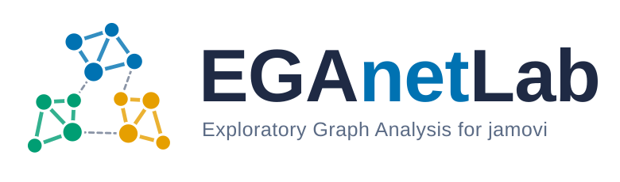

<p align="center">
  <picture>
    <source media="(prefers-color-scheme: dark)" srcset="docs/logo/eganetlab-logo-dark.svg">
    
  </picture>
</p>

<p align="center">
  <a href="LICENSE"></a>
  <a href="https://github.com/ArchieJamDev/EGAnetLab/releases"></a>
  <a href="https://github.com/ArchieJamDev/EGAnetLab/actions/workflows/jamovi-check.yml"></a>
  
  
</p>

> **A jamovi module for Exploratory Graph Analysis: how many dimensions your
> items measure, which items belong together, and how much you can trust
> that answer.**

EGAnetLab brings the network psychometrics of the
[EGAnet](https://r-ega.net) R package to [jamovi](https://www.jamovi.org/),
without writing a line of R. Like its sibling module
[AssumptionsLab](https://github.com/ArchieJamDev/AssumptionsLab), it does not
stop at the numbers: every option in the menu explains what it does and when
to choose it, and every result comes with a plain-language interpretation,
the evidence behind it and the next step to take.

---

## Contents

- [Why EGAnetLab?](#why-eganetlab)
- [Screenshots](#screenshots)
- [Analyses](#analyses)
- [Supported Data](#supported-data)
- [Network Graphics](#network-graphics)
- [Methodological Philosophy](#methodological-philosophy)
- [Installation](#installation)
- [Example Dataset](#example-dataset)
- [For Developers](#for-developers)
- [Roadmap](#roadmap)
- [Contributing](#contributing)
- [Citation](#citation)
- [License & Author](#license--author)
- [Resumen en español](#resumen-en-español)

---

## Why EGAnetLab?

Deciding how many dimensions a scale has is one of the most consequential
choices in measurement, and one of the most error-prone. Eigenvalue rules
over-extract, parallel analysis wobbles with ordinal data, and an EFA solution
says nothing about how stable it would be in a new sample.

**Exploratory Graph Analysis** (Golino & Epskamp, 2017) estimates the items'
network of partial correlations and finds its communities: each community is a
dimension. Simulation studies show it is as accurate as or more accurate than
traditional methods, and EGAnet adds the tools that turn one estimate into a
full argument: bootstrap stability, redundancy checks, information-theoretic
fit, hierarchical and longitudinal structure, and invariance across groups.

EGAnetLab puts that whole toolkit in jamovi's point-and-click interface:

- **A menu of decisions, not a wall of defaults.** Correlation type, network
  model, community algorithm and every other choice is an explicit option,
  each with an explanatory paragraph.
- **Guidance with every table.** A short guide before each result and an
  interpretation after it, in English or Spanish.
- **Publication-ready network plots.** Communities in colorblind-safe
  palettes, with layout, nodes, edges and labels under your control.
- **Validated against EGAnet.** The module's results are checked against
  direct EGAnet calls (see [`validation/`](validation/)).

---

## Screenshots

<!-- Images go in docs/screenshots/. Replace each file keeping its name. -->

<p align="center">
  
  <br><em>From item selection to dimensions, stability and interpretation.</em>
</p>

<table>
  <tr>
    <td width="50%"><br><em>The EGAnet Lab menu in jamovi.</em></td>
    <td width="50%"><br><em>Every estimation choice explained in the options panel.</em></td>
  </tr>
  <tr>
    <td width="50%"><br><em>Item network coloured by dimension.</em></td>
    <td width="50%"><br><em>Dimensions, membership, network loadings and interpretation.</em></td>
  </tr>
  <tr>
    <td width="50%"><br><em>Bootstrap stability of items and dimensions.</em></td>
    <td width="50%"><br><em>Redundant items flagged by Unique Variable Analysis.</em></td>
  </tr>
  <tr>
    <td width="50%"><br><em>Comparing network structure across groups.</em></td>
    <td width="50%"><br><em>Centrality indices with bootnet stability.</em></td>
  </tr>
</table>

---

## Analyses

EGAnetLab is organised as a menu of decisions. Each analysis is one entry in
the **EGAnet Lab** menu, and each option inside it carries its own
explanation.

### 1. Dimensional estimation (EGA core)

| Analysis | Question it answers | Status |
|---|---|---|
| **EGA** | How many dimensions are there, and which items belong to each? | ✅ 0.1.0 |
| **Bootstrap EGA** (`bootEGA`) | Would the same dimensions appear in hundreds of resamples, or are they sample noise? | ✅ 0.1.0 (in EGA, Stability section) |
| **Hierarchical EGA** (`hierEGA`) | Do the specific dimensions sit under one or more higher-order factors? | ✅ 0.1.0 (in EGA, Hierarchical and wording section) |
| **Random-intercept EGA** (`riEGA`) | Are positively and negatively worded items splitting into method dimensions? | ✅ 0.1.0 (in EGA, Hierarchical and wording section) |
| **Dynamic EGA** (`dynEGA`) | How does the structure unfold over time, per person, per group or for the population? | 🗓 Planned |

### 2. Diagnosis and psychometric quality

| Analysis | Question it answers | Status |
|---|---|---|
| **Network loadings** (`net.loads`) | How strongly does each item load on its dimension, and on the others? | ✅ 0.1.0 (in EGA) |
| **Item & dimension stability** | What percentage of resamples place each item in the same dimension? | ✅ 0.1.0 (in EGA, Stability section) |
| **Unique Variable Analysis** (`UVA`) | Which items are redundant and should be removed or combined? | ✅ 0.1.0 (in EGA, Redundancy section) |
| **Network scores** (`net.scores`) | What is each person's score per dimension (network score or item mean), saved back to the data? | ✅ 0.1.0 (in EGA, Network scores section) |
| **Invariance** (`invariance` + NetworkComparisonTest) | Is the structure equivalent across groups, or before and after an intervention? | 🗓 Planned |
| **Confirmatory test** (`CFA`) | Does the EGA structure hold as a confirmatory factor model, also in a random confirmation subsample? | ✅ 0.1.0 (in EGA, CFA section) |

### 3. Information theory and fit

| Analysis | Question it answers | Status |
|---|---|---|
| **TEFI** | Which of several competing structures fits the data best? | ✅ 0.1.0 (in EGA, Compare structures section: EGA vs. other algorithms and your theoretical structure) |

### 4. Network topology and graphics

| Analysis | Question it answers | Status |
|---|---|---|
| **Compare networks** (`compare.EGA.plots`) | How do two structures look side by side? | 🗓 Planned |
| **Centrality** (qgraph + bootnet) | Which items are central, and are those indices stable (CS-coefficient)? | 🗓 Planned |
| **Edge accuracy** (bootnet) | How precise is each edge weight (bootstrap confidence intervals)? | 🗓 Planned |

---

## Supported Data

EGAnetLab analyses **items measured on the same respondents**. It supports
three kinds of items, and adapts the correlation to each:

| Item type | Examples | Correlation used (`corr = "auto"`) |
|---|---|---|
| **Continuous** | Scale scores, reaction times, visual analogue scales | Pearson |
| **Ordinal** | Likert items with up to 7 categories | Polychoric |
| **Dichotomous** | Right/wrong test items, yes/no symptoms | Tetrachoric |

And, as the analyses grow, these designs:

- **Cross-sectional** samples (EGA, bootEGA, UVA, TEFI).
- **Scales with reversed items** and wording effects (riEGA).
- **Hierarchical** constructs (hierEGA).
- **Two or more groups**, independent or paired pre/post (invariance,
  NetworkComparisonTest).
- **Longitudinal and intensive** data such as ESM/EMA diaries (dynEGA).

Mixed networks with nominal or count variables are deliberately out of scope.

---

## Network Graphics

Network plots are drawn with EGAnet's own engine (GGally `ggnet2` on top of
ggplot2), and centrality plots with qgraph. Both are heavily parameterised,
with defaults equal to EGAnet's, so a beginner gets a clean plot and an
author preparing a figure gets full control:

| Group | Options |
|---|---|
| **Layout** | Fruchterman-Reingold, Kamada-Kawai, circle and other `sna` layouts |
| **Nodes** | Size, shape, transparency, border, palette (jamovi, Okabe-Ito colorblind, viridis) |
| **Labels** | Size, colour, item names or abbreviations |
| **Edges** | Width, positive/negative colours, transparency, line type, edge-weight labels, minimum weight shown |
| **Legend** | Show/hide, position, size |

---

## Methodological Philosophy

1. **Decisions, not defaults.** Every estimation choice is visible and
   explained; the module never hides a decision from the user.
2. **Evidence over a single estimate.** A dimension count is a claim that
   needs support: stability, redundancy, fit and invariance.
3. **Explain, then report.** Guides before results, interpretations after,
   in the language of the report.
4. **Fidelity to EGAnet.** EGAnetLab calls EGAnet; it does not reimplement it.
   Results match the R package and are validated against it.
5. **Transparent failure.** When something cannot be computed, the output
   says what and why, instead of silently dropping it.

---

## Installation

### From a release (recommended)

1. Download the latest `EGAnetLab_x.y.z.jmo` from
   [Releases](https://github.com/ArchieJamDev/EGAnetLab/releases).
2. In jamovi, open the **⋮** menu (top right) → **Modules** →
   **Install from file**, and choose the `.jmo` file.
3. The **EGAnet Lab** menu appears in the Analyses ribbon.

### From source

```r
install.packages("jmvtools", repos = c("https://repo.jamovi.org", "https://cran.r-project.org"))
jmvtools::install()   # from the repository root, with jamovi installed
```

---

## Example Dataset

EGAnetLab ships the **WMT-2 Matrices Test** data (n = 1185) from EGAnet:
18 dichotomous reasoning items (`wmt1` to `wmt18`) plus demographics. Open it
from jamovi's **⋮** → **Open** → **Data Library** → **EGAnet Lab**. See
[`data/README.md`](data/README.md).

---

## For Developers

- [ARCHITECTURE.md](ARCHITECTURE.md): how the module is built and why.
- [DEVELOPER_GUIDE.md](DEVELOPER_GUIDE.md): workflow, testing and releases.
- [CODE_STYLE.md](CODE_STYLE.md): conventions for R, YAML and texts.
- [docs/Bibliography.md](docs/Bibliography.md): the references behind every
  result.

```r
jmvtools::prepare()                 # regenerate .h.R files from the YAML
testthat::test_dir("tests/testthat") # run the edge-case suite
source("validation/ega_equivalence.R") # compare with EGAnet::EGA
```

---

## Roadmap

| Phase | Content | Status |
|---|---|---|
| 0 | Platform, EGA analysis, CI, documentation | ✅ Done |
| 1 | Bootstrap EGA, item and dimension stability | ✅ Done |
| 2 | UVA, network scores, CFA with random split | ✅ Done |
| 3 | TEFI comparison of competing structures | ✅ Done |
| 4 | Hierarchical EGA and random-intercept EGA | ✅ Done |
| 5 | Invariance and NetworkComparisonTest (independent and paired groups) | 🗓 |
| 6 | Centrality, edge accuracy and network comparison plots | 🗓 |
| 7 | Dynamic EGA for longitudinal and intensive data | 🗓 |

See [NEWS.md](NEWS.md) for what changed in each version.

---

## Contributing

Bug reports, ideas and pull requests are welcome. Please read
[CONTRIBUTING.md](CONTRIBUTING.md) first.

---

## Citation

If you use EGAnetLab in your research, please cite the module and EGAnet.
Citation metadata is in [CITATION.cff](CITATION.cff) (GitHub's **Cite this
repository** button uses it).

> Chacón Chacón, A. D. L. (2026). *EGAnetLab: A jamovi module for Exploratory
> Graph Analysis* (Version 0.1.0) [Computer software].
> https://github.com/ArchieJamDev/EGAnetLab

> Golino, H., & Christensen, A. P. (2026). *EGAnet: Exploratory graph
> analysis – A framework for estimating the number of dimensions in
> multivariate data using network psychometrics* (Version 2.4.1) [R package].
> https://r-ega.net

The methods behind each analysis are listed in
[docs/Bibliography.md](docs/Bibliography.md).

---

## License & Author

EGAnetLab is released under the [GNU General Public License v3.0](LICENSE).
It depends on EGAnet, which is licensed under AGPL-3.0; combining the two is
permitted by section 13 of the GPL-3.0.

**Arquímedes De León Chacón Chacón**: Psychologist · Data Scientist ·
Research Methodologist. Project Founder and Lead Developer.
Universidad Católica Andrés Bello (UCAB), Caracas, Venezuela.
[ORCID](https://orcid.org/0000-0002-7014-7513)

Copyright © 2026 Arquímedes De León Chacón Chacón

---

## Resumen en español

**EGAnetLab** es un módulo de jamovi para el Análisis Exploratorio de Grafos
(EGA) basado en el paquete de R EGAnet. Permite estimar cuántas dimensiones
mide un conjunto de ítems y qué ítems pertenecen a cada una, y luego evaluar
la solidez de esa respuesta: estabilidad por bootstrap, redundancia (UVA),
ajuste (TEFI), estructuras jerárquicas, efectos de redacción, invarianza entre
grupos (incluido pre/post) y cambio en el tiempo.

Trabaja con ítems continuos, ordinales y dicotómicos. Cada opción del menú
incluye un párrafo que explica qué hace y cuándo conviene elegirla, y los
resultados se acompañan de guías e interpretaciones en español o inglés. Los
gráficos de red son altamente configurables (disposición, nodos, etiquetas,
aristas y leyenda) y usan paletas aptas para daltonismo.

Para instalarlo, descargue el archivo `.jmo` desde
[Releases](https://github.com/ArchieJamDev/EGAnetLab/releases) y, en jamovi,
use **⋮** → **Modules** → **Install from file**.
